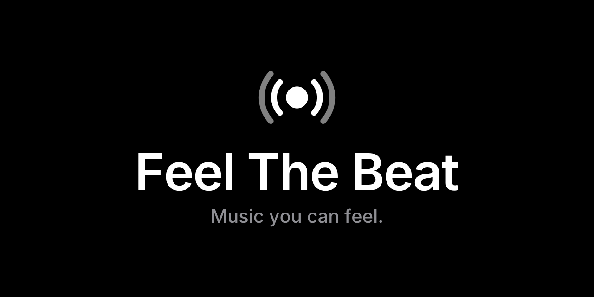
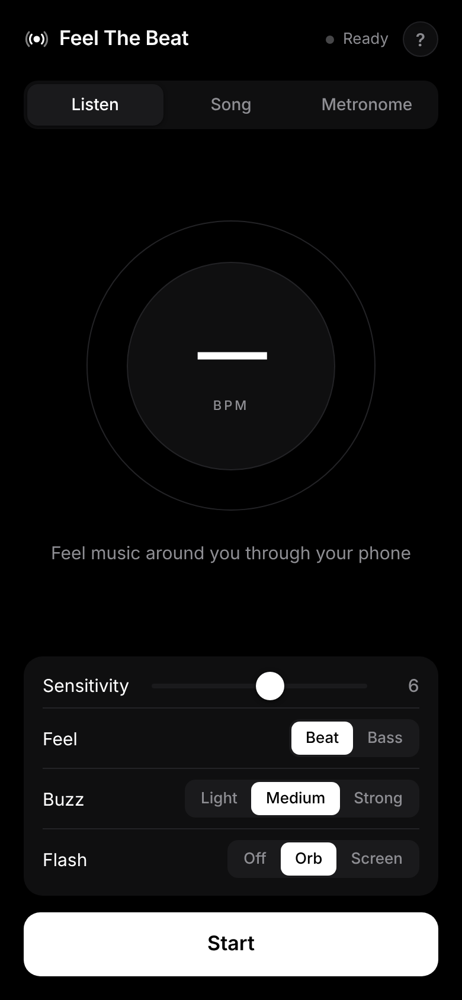
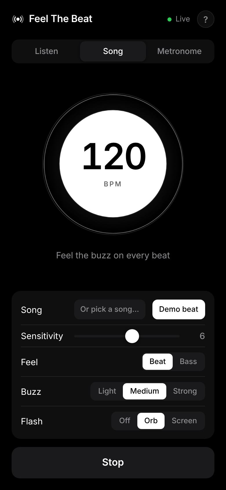
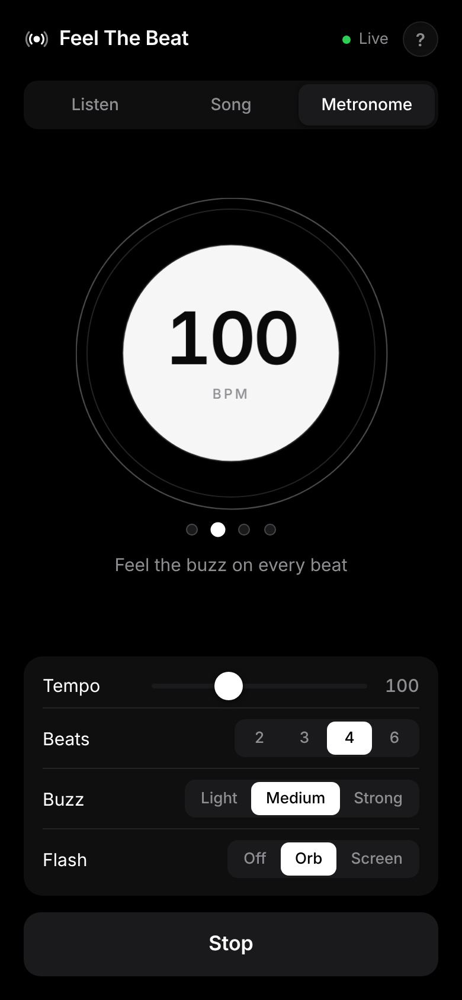
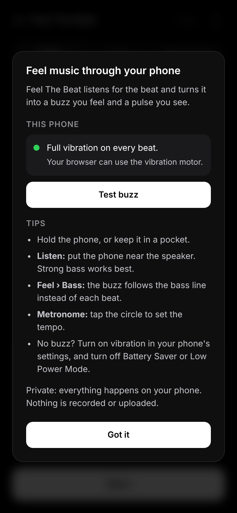
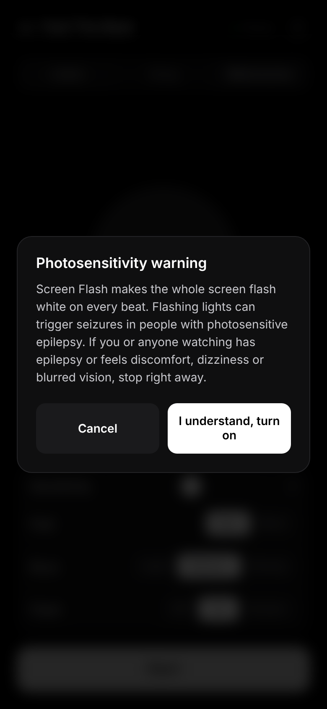

<p align="center">
  
</p>

<h1 align="center">Feel The Beat: music for the deaf</h1>

<p align="center">
  <b>Music you can feel.</b><br>
  Feel The Beat turns music into vibration and light, so deaf and hard-of-hearing people can feel every beat.
</p>

<p align="center">
  <a href="https://feel-the-beat-app.netlify.app"><b>▶ Open the app</b></a> ·
  <a href="native/README.md">iPhone &amp; Android apps</a> ·
  <a href="PRIVACY.md">Privacy</a> ·
  <a href="ROADMAP.md">Roadmap</a> ·
  <a href="STORE_LISTING.md">Press &amp; store copy</a>
</p>

---

## Why

Music is felt as much as it's heard: the kick drum in your chest, the bass through the floor. Feel The Beat puts that feeling in your hand. It listens for the beat and turns each one into a buzz you feel and a pulse you see, in real time.

No account. No ads. Nothing to set up. Open it and press **Start**.

<p align="center">
  
  
  
  
  
</p>

## Features

| | |
|---|---|
| **Listen** | Uses the microphone to feel music playing around you: at a concert, in the car, at a party. |
| **Song** | Pick a song on your phone, or tap **Demo beat**, and feel it as it plays. |
| **Metronome** | A steady beat from 40–220 BPM, 2, 3, 4 or 6 beats per bar, with a stronger buzz and beat dots on beat 1. Tap the circle to set the tempo. |
| **Feel: Beat or Bass** | **Beat** buzzes once per beat, harder for harder hits. **Bass** makes the buzz follow the bass line. |
| **Live BPM** | Shows the tempo of what you're feeling. |
| **Buzz strength** | Light, Medium or Strong. |
| **Visual pulse** | A pulse and a bass glow on every beat, with an optional full-screen flash (off by default, behind a photosensitivity warning). |
| **Test buzz** | The **?** button shows what your phone can do, lets you test the buzz, and gives tips. |
| **Remembers you** | Keeps your settings for next time. |
| **Private by design** | All listening happens on your device. No audio is recorded, stored or sent anywhere. |
| **Works offline** | Once opened, it keeps working without a connection. |

## Get it on your phone

1. Open **https://feel-the-beat-app.netlify.app** on your phone.
2. **iPhone (Safari):** tap Share → **Add to Home Screen**.
   **Android (Chrome):** tap ⋮ → **Install app** / **Add to Home screen**.
3. Launch it from your home screen like any other app.

### Phone support

| | Vibration | Visual pulse | Mic / Song / Metronome |
|---|---|---|---|
| **Android app** | ✅ Full vibration | ✅ | ✅ |
| **Android website** (Chrome, Edge, Samsung Internet) | ✅ Full vibration | ✅ | ✅ |
| **iPhone app** | ✅ Full haptics (Taptic Engine) | ✅ | ✅ |
| **iPhone website** (Safari) | ⚠️ Light taps on iOS 18–26.4, none on iOS 26.5+* | ✅ | ✅ |

\* Apple doesn't let websites use the vibration motor, and iOS 26.5 blocked the tap trick websites used. **For vibration on iPhone, use the app.** See [native/README.md](native/README.md) for how to build and install the iPhone and Android apps (the Android test app can be downloaded from the repo's Actions tab).

## How it works

- Audio (from the mic, a song, or the built-in demo) passes through a **low-pass filter at 150 Hz**. That keeps the kick drum and bass, where the beat lives.
- The app tracks bass energy about 60 times a second and compares it to the last second of audio. When the energy jumps above the recent average by an amount set with the **Sensitivity** slider, it counts a beat.
- Each beat triggers a buzz and the visual pulse. Harder hits buzz longer. The app uses the Haptics plugin in the native apps, `navigator.vibrate` in Android browsers, and the iOS switch tap in iPhone browsers.
- **Bass** feel measures how loud the bass is about 20 times a second and runs the motor for that share of each moment, so you feel the bass line rise and fall.
- The BPM is the median of recent beat gaps, so one stray hit doesn't throw it off.

Tested with real music: it locked onto a 90 BPM track within 5 seconds and held it, and it detects the 120 BPM demo beat exactly. Automated browser tests check that each kind of phone gets the right buzz on every beat, through the microphone, a song and the metronome.

## Safety

**Photosensitivity warning:** Screen Flash mode flashes the whole screen on each beat. Flashing light can trigger seizures in people with photosensitive epilepsy. It's **off by default**, needs you to confirm a warning before it turns on, and is limited to 3 flashes per second.

## Tech

A single-file progressive web app. Plain HTML, CSS and JavaScript using the Web Audio API, with no frameworks and no build step. The iPhone and Android apps wrap the same file with [Capacitor](https://capacitorjs.com).

```
index.html            the app
manifest.webmanifest  install info (name, icons, colors)
sw.js                 offline support
icons/                app icons
brand/                logos, app icon, banner (SVG + PNG)
screenshots/          app screenshots
native/               iPhone (ios/) and Android (android/) apps — see native/README.md
scripts/build-web.mjs copies the web app into dist/ (Netlify) or native/www/ (apps)
netlify.toml          Netlify hosting settings
```

Run it locally: `python3 -m http.server` in this folder, then open `http://localhost:8000`.

### Hosting

The website is hosted on **Netlify** at [feel-the-beat-app.netlify.app](https://feel-the-beat-app.netlify.app). `netlify.toml` tells Netlify to publish only the web app. With the repo linked in Netlify, every push to `main` goes live on its own.

## Roadmap

Publish the iPhone and Android apps on the App Store and Google Play. See [ROADMAP.md](ROADMAP.md).

---

<p align="center">© 2026 John Wood. All rights reserved.</p>
